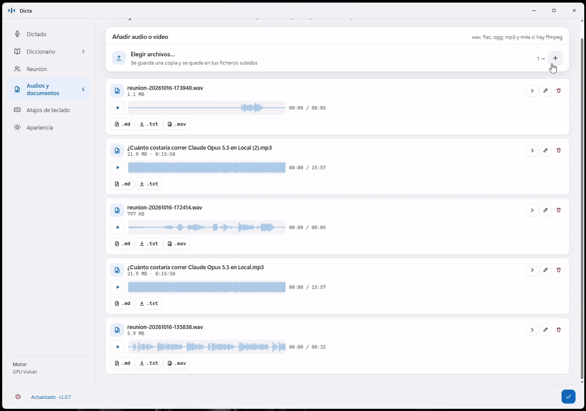
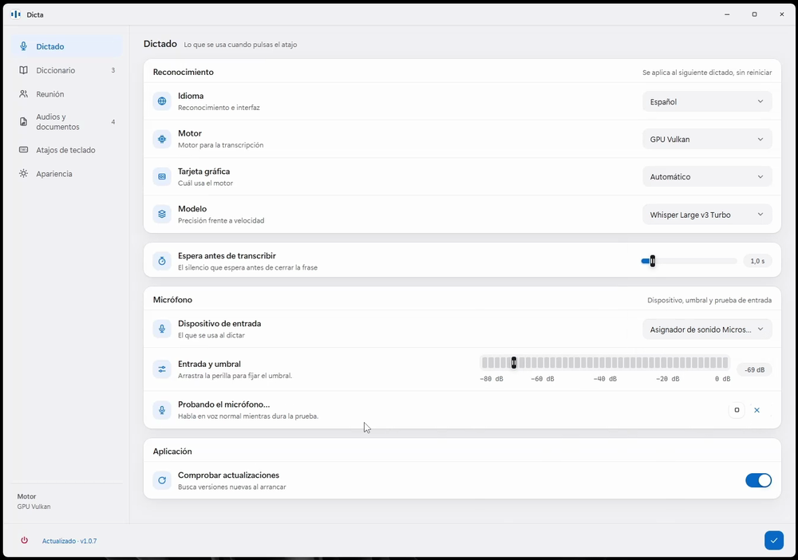
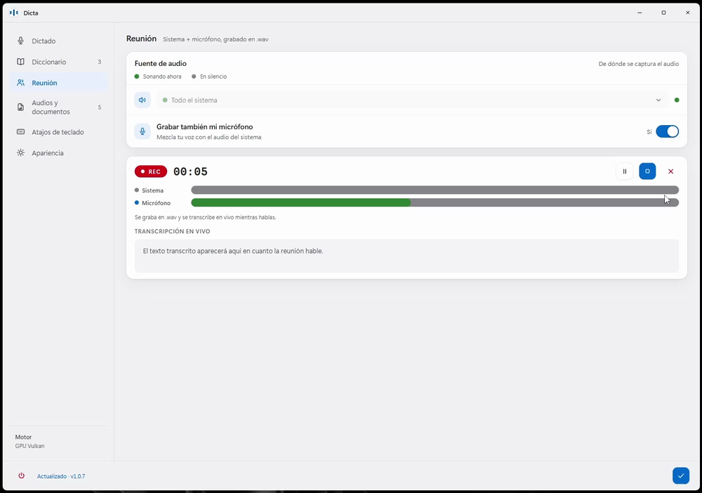

# dicta — dictado y transcripción de voz 100 % local

[](https://github.com/JDMoreu/dicta/releases/latest)
[](#requisitos)
[](LICENSE)

Pulsas **Alt+Q**, hablas y vuelves a pulsar: el texto aparece donde tengas el
cursor. También graba reuniones y transcribe audios y vídeos. Todo ocurre en tu
equipo: **el audio y el texto no salen de tu PC**.



*Esa es la demo real (10 s): se añade un audio, se transcribe solo y el resultado
aparece en el panel. El [vídeo completo (1 min)](https://github.com/JDMoreu/dicta/releases/download/v1.0.7/Dicta_demo.mp4)
está adjunto en la release.*

## Qué hace

- **Dictado (Alt+Q)** — el texto se inserta en la ventana activa al parar de
  hablar (o tras una pausa). Al dictar aparece arriba la **isla**, una muesca
  pequeña con la onda de tu voz. **Alt+E** cancela el dictado en curso.
- **Reunión** — graba el **audio del sistema** (o solo el de una aplicación
  concreta, p. ej. Teams o el navegador) **y tu micrófono** en un `.wav` estéreo,
  y transcribe la reunión **en vivo**.
- **Audios y documentos** — sueltas wav, flac, ogg, mp3 o m4a y se transcriben en
  cola con barra de progreso y vista previa de la onda. Cada uno deja un
  documento que puedes leer, editar, descargar en `.md` o `.txt`, o borrar.
- **Diccionario** — los términos y nombres propios que dictas a menudo, para que
  salgan bien escritos.

## Cómo se usa (sin instalar nada)

1. Descarga **`dicta-portable-1.0.7-windows-x64.zip`** desde
   [Releases](https://github.com/JDMoreu/dicta/releases/latest).
2. Descomprímelo en una carpeta escribible (p. ej. `%LOCALAPPDATA%\Programs\dicta`).
3. Ejecuta **`dicta.exe`** y acepta el aviso de administrador.

No hace falta Python ni instalar nada más, pero **la carpeta se distribuye
completa**: el `.exe` solo no arranca. Si el modelo de whisper que elijas no está
en `models\`, se descarga solo la primera vez desde HuggingFace.

### Notas honestas

- **Ventanas elevadas.** Si la aplicación donde quieres pegar corre como
  administrador, dicta tiene que correr igual: el `.exe` ya pide permisos al
  abrir; desde el código, arráncalo con `run.bat` y acepta el aviso de UAC.
  Windows bloquea la automatización entre procesos de distinto nivel, así que no
  hay forma de evitarlo. No hay que desactivar Windows Defender.
- **El panel** usa Chrome o Edge en modo aplicación (o WebView2). Sin ninguno de
  ellos el dictado y las transcripciones funcionan igual, pero los ajustes quedan
  solo en el menú de la bandeja.
- **Windows 11 esconde los iconos nuevos de la bandeja.** Si no ves el de dicta
  junto al reloj: Configuración → Personalización → Barra de tareas → Otros
  iconos de la bandeja del sistema → dicta.

## Ajustes (panel)

Secciones **Dictado**, **Diccionario**, **Reunión**, **Audios y documentos**,
**Atajos de teclado** y **Apariencia**. En el pie, el motor activo y la versión
(`Actualizado · v1.0.7`).

| Dictado: idioma, motor, modelo y micrófono | Reunión: grabando sistema + micrófono |
|---|---|
|  |  |

## Motor de transcripción

- **Automático** — lo mejor disponible: CUDA si hay NVIDIA, si no Vulkan, si no CPU.
- **GPU Vulkan** — vale para **AMD, Intel y NVIDIA**; carga el modelo una vez en
  la GPU y cada dictado es una petición local. En una RX 9070, `turbo` transcribe
  10 s en **~0,17 s** (≈60× tiempo real).
- **GPU CUDA** — para NVIDIA, colocando ese build en `whisper_cuda\`.
- **CPU** — respaldo universal.

Modelos `tiny`, `base`, `small`, `medium` y `turbo` (recomendado con GPU): se
descargan al seleccionarlos.

## Privacidad

**El audio y el texto nunca salen del equipo.** La única conexión que la app abre
por sí sola es la **comprobación de versión**: un `GET` anónimo a la lista
pública de releases de GitHub, sin ningún dato tuyo. Viene activada por defecto y
se puede desactivar con su interruptor. Lo demás lo inicias tú: la descarga de un
modelo que falte y la de una actualización si pulsas el botón.

## Desde el código

```bat
git clone https://github.com/JDMoreu/dicta && cd dicta
py -3.12 -m venv .venv
.venv\Scripts\python.exe -m pip install -r requirements.txt
run.bat            :: abre el panel y queda en la bandeja
```

Los binarios de whisper.cpp (`whisper_vulkan\`, `whisper_bin\`) y los modelos
(`models\*.bin`) no se versionan. Opciones útiles de `run.bat`:

```bat
run.bat --mode hold            :: mantener Alt+Q pulsada mientras hablas
run.bat --hotkey ctrl+alt+d    :: otra combinación
run.bat --engine vulkan        :: auto | vulkan | cuda | cpu
run.bat --model turbo          :: más precisión (recomendado con GPU)
run.bat --file ruta\audio.flac :: prueba rápida con un archivo
run.bat --list-mics            :: lista micrófonos
run.bat --no-panel             :: no abrir los ajustes al arrancar
```

Atajos globales: **Alt+Q** dicta, **Alt+E** cancela y **Ctrl+Alt+P** abre los
ajustes. Los tres se cambian en el panel.

Para el ejecutable portable:

```bat
build_exe.bat      :: crea dist\dicta\dicta.exe (onedir, sin consola, manifiesto de admin)
```

`dist\dicta\` se distribuye **completa** (el `.exe` solo no arranca): dentro va
`_internal\` con `panel\` y los motores. `models\` es **externa** y se copia
aparte. Instálalo en una carpeta escribible; en `Program Files` el perfil del
panel necesita permisos de escritura.

## Arquitectura (resumen)

- El atajo usa una cola: el hilo detector no toca Tk, el foco ni la
  transcripción; los cambios de estado y el pegado se aplican desde Tk.
- Inserción por UI Automation (`ValuePattern.SetValue`) y Ctrl+V como respaldo;
  el texto queda en el portapapeles aunque el pegado automático se rechace.
- El panel es same-origin: `dicta.py` sirve `panel/` y la API (`GET /state`,
  `POST /rpc`) en `127.0.0.1:47810`, solo en local, sin CORS ni puentes.
- La isla es una ventana *layered* con transparencia real por píxel
  (`dicta_ui.py` sobre `dicta_layered.py`): un solo DIB cuyo tamaño se recrea
  para que coincida con el fotograma, y `WM_NCHITTEST` devolviendo
  `HTTRANSPARENT` sobre los píxeles transparentes.
- Todo el Win32 lleva `argtypes`/`restype` declarados: sin eso ctypes trunca los
  punteros y las ventanas no llegan a crearse.
- La captura por aplicación (`dicta_capture.py`) es WASAPI *process loopback* en
  `ctypes` puro, sin instalar nada; si falla, la reunión sigue con el micrófono.
- `whisper-server` **ignora el flag `-l`** al arrancar: el idioma y el prompt
  viajan en cada petición, así que cambiar de idioma o el diccionario no reinicia
  nada.
- Un solo símbolo recorre la app, **la onda de dicta** (5 cápsulas con degradado
  teal → azul → violeta), dibujada por una única función
  (`dicta_icon.wave_mark`) para la isla, la bandeja y el icono.

## Requisitos

- Windows 10/11 de 64 bits.
- El portable: nada más. Desde el código: Python 3.12, y Chrome o Edge para el panel.
- La primera vez se descarga el modelo de whisper elegido (p. ej.
  `large-v3-turbo`, ~574 MB).

## Licencia

MIT — ver [LICENSE](LICENSE).
